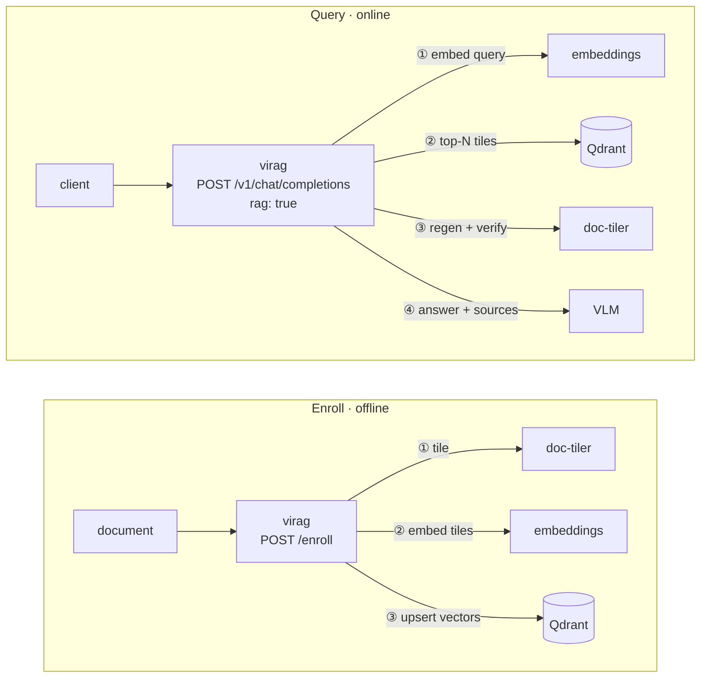

# virag — pixel-RAG over Qdrant + doc-tiler

A production-oriented **pixel (screenshot) RAG** stack: documents are rendered to image
tiles, embedded with a multimodal model, and retrieved as images at query time — no OCR,
no text extraction. A client talks to one OpenAI-compatible endpoint and opts into
retrieval per request.

This repository holds two independently deployable services:

| Service | Role | Docs |
|---|---|---|
| [**virag/**](virag/) | The OpenAI-compatible `/v1` gateway. Enables pixel-RAG on demand: retrieves tiles, injects them into the prompt, forwards to an upstream vision model. | [virag/README.md](virag/README.md) · [virag/docs/](virag/docs/) |
| [**doc-tiler/**](doc-tiler/) | Turns PDF/URL/MHTML/IMG documents into fixed-geometry image tiles and regenerates any tile on demand from the stored original. | [doc-tiler/README.md](doc-tiler/README.md) · [doc-tiler/docs/](doc-tiler/docs/) |

Two more components are external dependencies the stack talks to: a **Qdrant** vector
store and a **vLLM** embeddings server (both wired up by virag's Compose file), plus the
upstream **VLM** that generates the answers.

## How it fits together



- **Enroll** a document once: virag has doc-tiler tile it, embeds the tiles, and upserts
  the vectors (with `doc_id`/`tile_num`/`image_hash` payloads) into Qdrant.
- **Query** with `rag` on: virag embeds the question, finds the closest tiles, regenerates
  them from doc-tiler, verifies each tile's hash against what was enrolled, injects the
  images into the prompt, and forwards to the VLM.

The three stateful parts (virag, doc-tiler, the Qdrant collection) are locked together by
one shared secret (`TILER_DB_SECRET`) so a mismatched pair refuses to start — see
[virag/docs/SECURITY.md](virag/docs/SECURITY.md).

## Getting started

Each service is self-contained (its own `Dockerfile`, package, `deploy/`). The full stack
comes up from virag's Compose file:

```bash
cd virag/deploy
cp .env.example .env      # set TILER_DB_SECRET, VLM_BASE_URL, VLM_MODEL_NAME, QDRANT_VECTOR_SIZE
docker compose up --build
```

Start with **[virag/README.md](virag/README.md)** for the gateway and
**[doc-tiler/README.md](doc-tiler/README.md)** for the tiling service.
